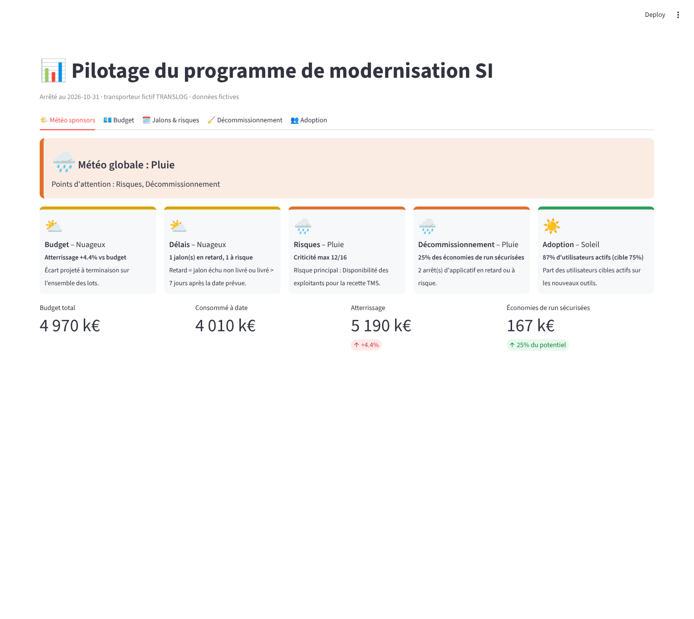
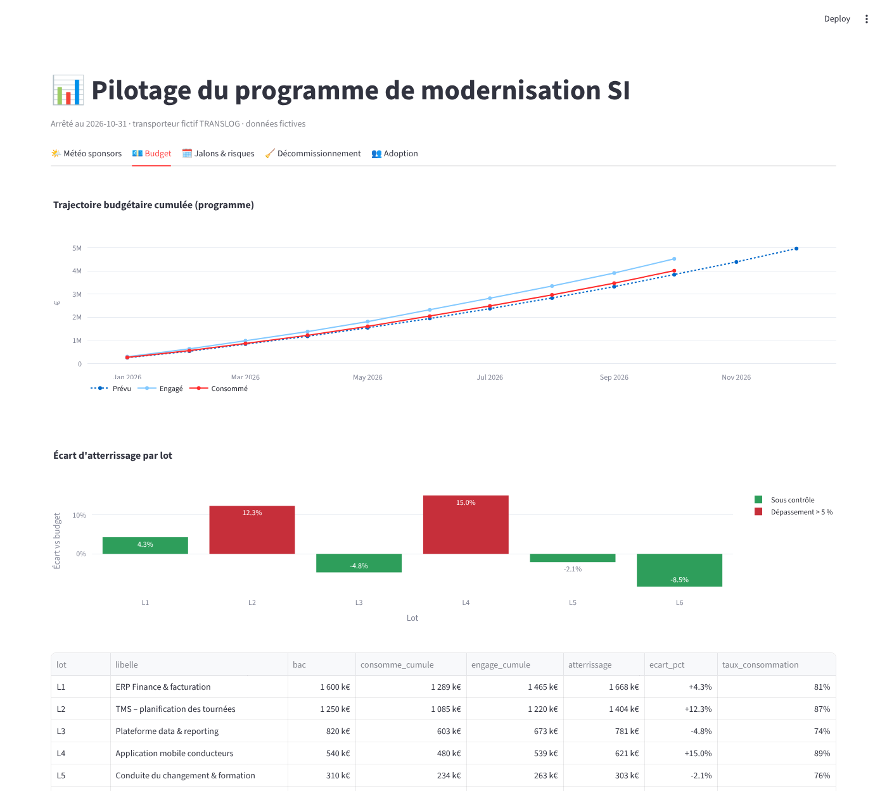
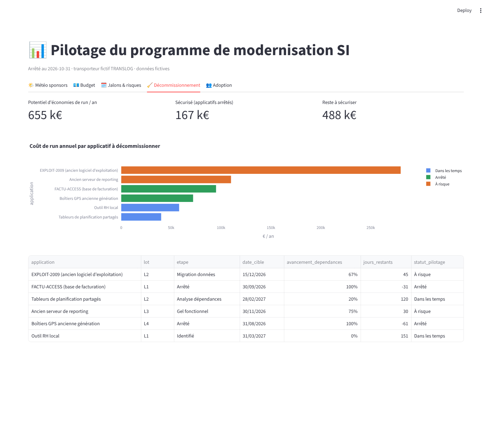
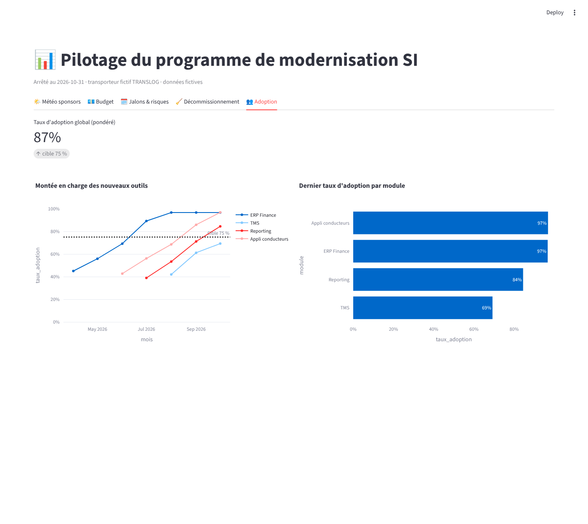
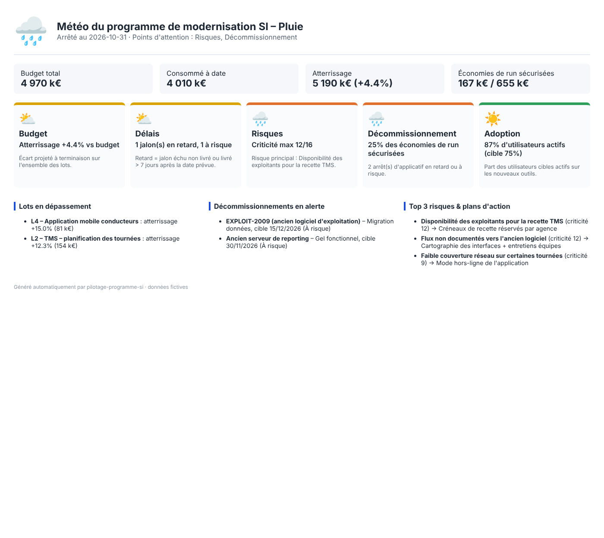

# 📊 Pilotage PMO d'un programme de modernisation SI

Outil de **pilotage de programme (PMO)** en Python, appliqué à la modernisation du système d'information d'un transporteur routier **fictif** (TRANSLOG) : ERP, TMS, plateforme data et application mobile pour les conducteurs.

Il couvre le suivi budgétaire, une **météo synthétique pour les sponsors**, les jalons et les risques, le **décommissionnement des applications remplacées** et l'**adoption des nouveaux outils**.

> ⚠️ Toutes les données sont **fictives** et générées par script. Le projet illustre des méthodes de pilotage. L'entreprise, les applications et les montants sont inventés.



## 🎯 Ce que le projet couvre

| Besoin de pilotage | Ce que fait l'outil |
|---|---|
| **Suivre le budget du programme** | Prévu / engagé / consommé par lot et par mois. Calcul de l'**atterrissage** (projection du coût final), des écarts, et alerte automatique au-delà de 5 % de dépassement. |
| **Donner une météo synthétique aux sponsors** | 5 axes (budget, délais, risques, décommissionnement, adoption) notés ☀️ ⛅ 🌧️ ⛈️ selon des **règles explicites et paramétrables**. Génération d'un **one-pager HTML** prêt à envoyer. |
| **Suivre les jalons et les risques** | Jalons en retard ou à risque, matrice probabilité × impact et plans d'action. |
| **Mesurer l'adoption** | Taux d'utilisateurs actifs par module et montée en charge depuis la mise en service, comparés à une cible. |
| **Piloter le décommissionnement** | Étapes d'arrêt, dépendances traitées, échéances, statut (*dans les temps / à risque / en retard*) et **économies de run sécurisées** comparées au potentiel. |

## 🖼️ Aperçu

| Budget | Décommissionnement |
|---|---|
|  |  |

| Adoption | Météo envoyée aux sponsors (one-pager) |
|---|---|
|  |  |

## 🧮 Règles de calcul

**Budget**
- `indice de performance = consommé cumulé / prévu cumulé` (une valeur > 1 indique une surconsommation)
- `atterrissage = budget total du lot × indice de performance`
- Un lot passe en alerte si l'atterrissage dépasse le budget de plus de 5 %

**Météo** (seuils dans `src/pmo/meteo.py`)

| Axe | ☀️ Soleil | ⛅ Nuageux | 🌧️ Pluie | ⛈️ Orage |
|---|---|---|---|---|
| Budget (écart d'atterrissage) | ≤ 2 % | ≤ 5 % | ≤ 10 % | > 10 % |
| Délais (part de jalons en retard ou à risque) | ≤ 10 % | ≤ 25 % | ≤ 40 % | > 40 % |
| Risques (criticité max = probabilité × impact) | ≤ 6 | ≤ 9 | ≤ 12 | > 12 |
| Adoption (écart à la cible de 75 % d'utilisateurs actifs) | cible atteinte | ≤ 5 pts | ≤ 15 pts | > 15 pts |

La **météo globale** est la moyenne des axes, arrondie vers le pessimiste. Elle ne peut jamais être meilleure que le pire axe moins un cran : un orage sur un axe ne peut pas se cacher dans la moyenne.

**Décommissionnement.** Un applicatif est *à risque* quand son échéance tombe dans moins de 60 jours alors que moins de 80 % de ses dépendances sont traitées. Il est *en retard* quand l'échéance est dépassée et qu'il n'est toujours pas arrêté.

## 🚀 Lancer le projet

```bash
pip install -r requirements.txt
python data/generate_data.py        # génère les données fictives (CSV)
streamlit run app.py                # tableau de bord interactif
python reports/meteo_sponsors.py    # one-pager météo pour les sponsors (HTML)
pytest -q                           # tests unitaires
```

## 🗂️ Structure

```
├── app.py                      # Tableau de bord Streamlit (5 onglets)
├── data/generate_data.py       # Génération des données fictives
├── src/pmo/
│   ├── budget.py               # Synthèse par lot, atterrissage, trajectoire, alertes
│   ├── meteo.py                # Règles de météo par axe + météo globale
│   ├── decommissionnement.py   # Statuts d'arrêt et économies de run
│   ├── adoption.py             # Taux d'adoption par module
│   └── indicateurs.py          # Calcul de tous les indicateurs à une date d'arrêté
├── reports/meteo_sponsors.py   # Génération du one-pager sponsors
├── tests/test_pmo.py           # Tests unitaires (pytest)
└── .github/workflows/ci.yml    # Intégration continue : tests + génération du rapport
```

## 🛠️ Stack
Python · pandas · NumPy · Plotly · Streamlit · pytest · GitHub Actions

---
Projet réalisé par **Teede Augustin NOUDAMADJO**, étudiant en Master 2 Big Data & IA (ESTIAM Lyon) et Data Scientist en alternance. [LinkedIn](https://www.linkedin.com/in/teede-noudamadjo)
